<p align="center">
  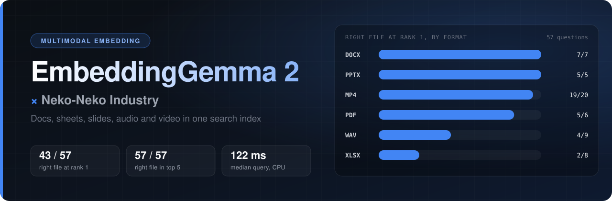
</p>

<h1 align="center">EmbeddingGemma 2 × ネコネコインダストリー</h1>

<p align="center">
  <b>Word・Excel・音声・動画を、1つの索引でまとめて検索できるのか。</b><br>
  Google EmbeddingGemma 2 を架空企業の社内資料14点・75問で実測した記録と、再現用コード一式。
</p>

<p align="center">
  
  
  
  <br>
  
  
  
  
  
</p>

<p align="center">
  <a href="ARTICLE.md"><b>解説記事</b></a> ·
  <a href="#結果">結果</a> ·
  <a href="#自分の資料で試す">クイックスタート</a> ·
  <a href="#フォルダ構成">フォルダ構成</a> ·
  <a href="docs/REPORT.md">実測レポート</a>
</p>

---

Googleの埋め込みモデル [EmbeddingGemma 2](https://huggingface.co/google/embeddinggemma-2)（2026年10月6日公開、文章・画像・音声・動画に対応）を、Podman Compose上のCPUだけで動かしました。架空企業「ネコネコインダストリー」のWord・PDF・Excel・PowerPoint・音声・動画を1つの索引に入れ、日本語の質問で答えの載った資料を探せるかを採点しています。音声と動画は文字起こしをせず、ファイルのままモデルに渡しました。

<p align="center">
  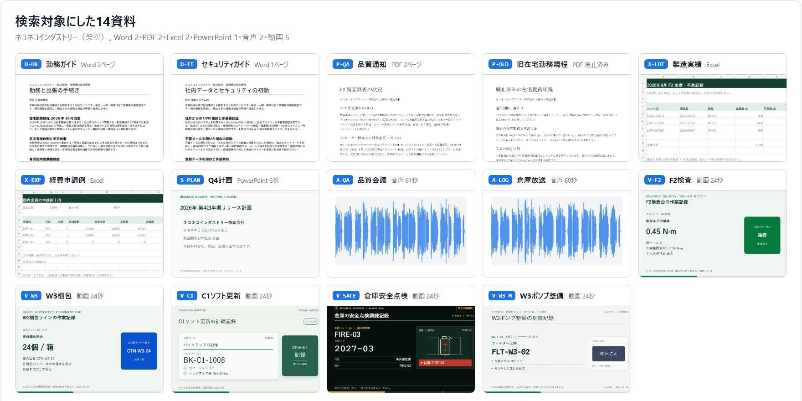
</p>

<details>
<summary>入力した資料の中身（形式ごとのタイル画像）</summary>

<p align="center">
  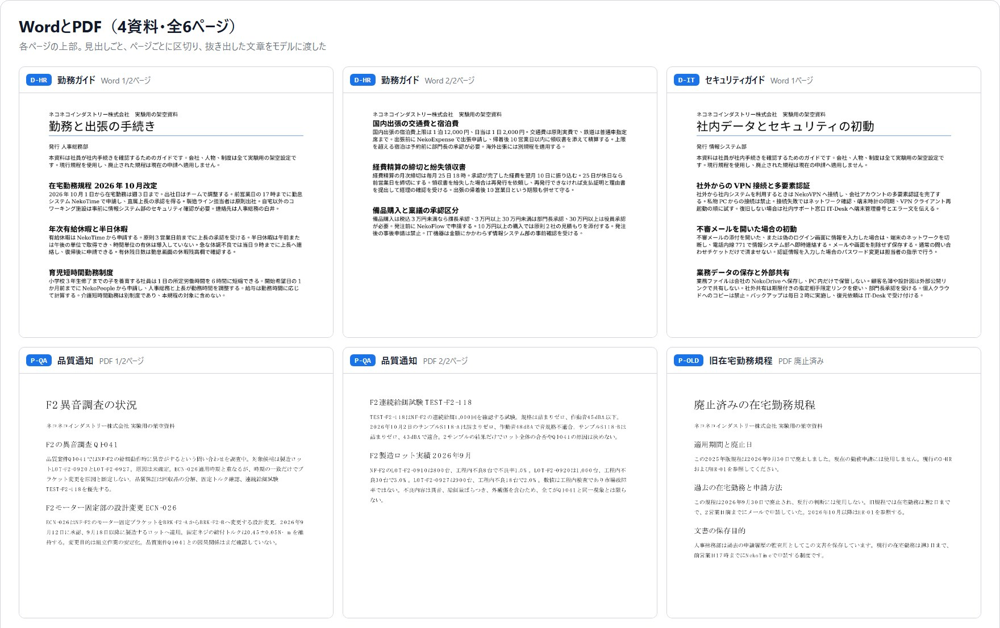
  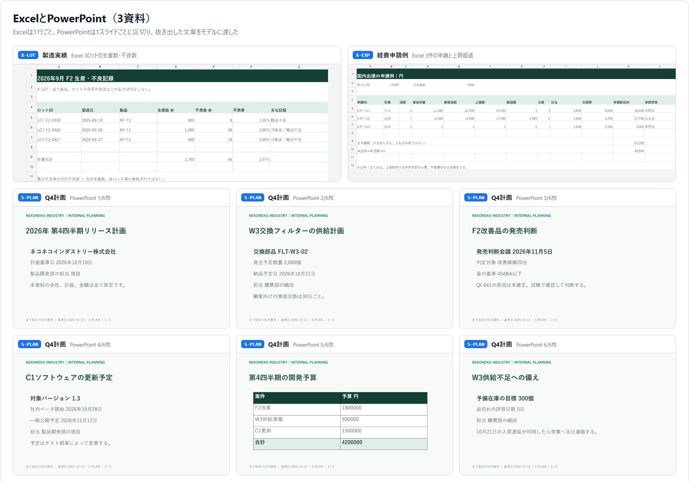
  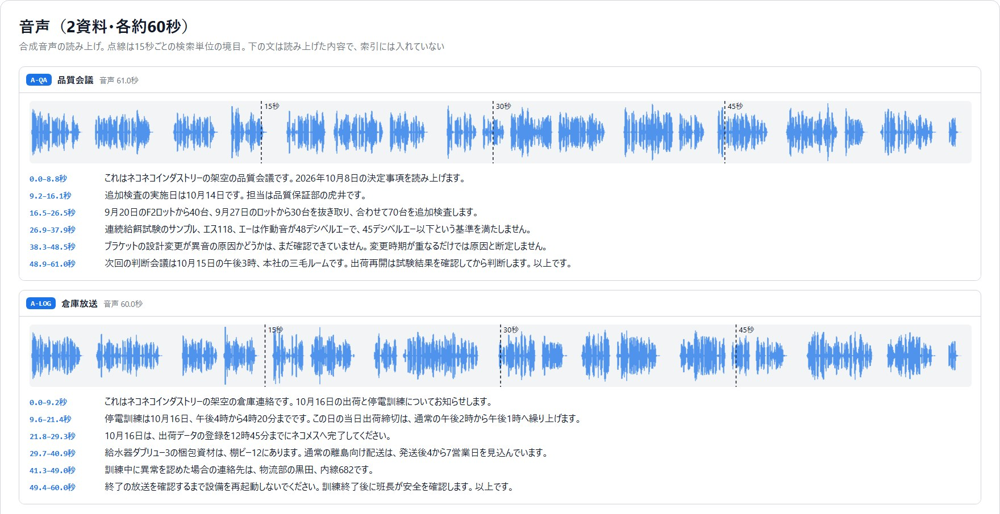
  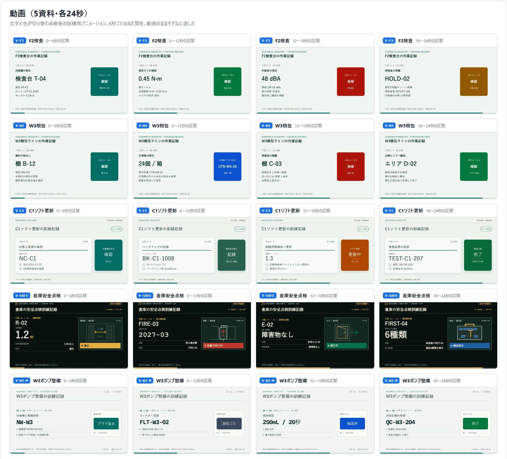
</p>

音声の図にある文は読み上げた内容で、索引には入れていません。

</details>

## 結果

答えの載った資料が1位に出たのは57問中43問、上位5件まで見れば57問すべてでした（2026-10-10、CPU 4スレッド）。

<p align="center">
  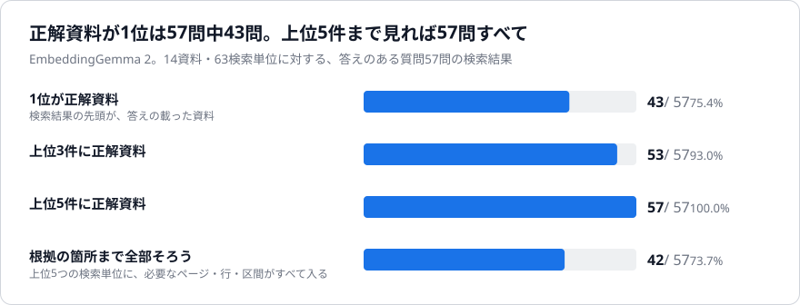
</p>

<p align="center">
  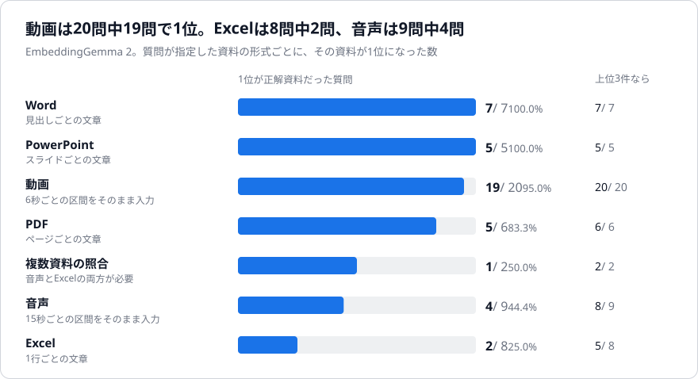
</p>

<p align="center">
  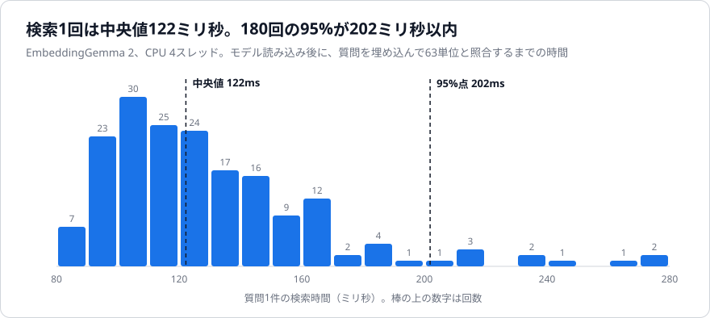
</p>

<p align="center">
  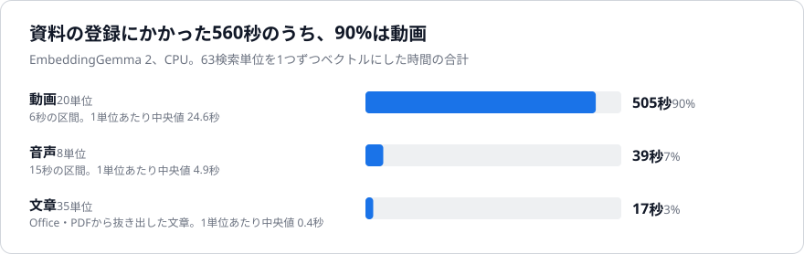
</p>

<p align="center">
  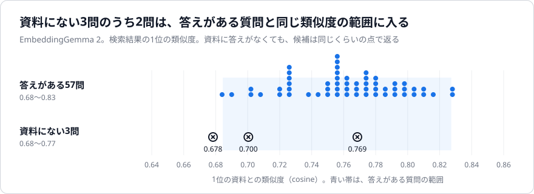
</p>

<details>
<summary>グラフの元になった数値</summary>

| 資料の形式 | 1位が正解 | 上位3件 | 上位5件 |
| --- | ---: | ---: | ---: |
| Word | 7 / 7 | 7 / 7 | 7 / 7 |
| PowerPoint | 5 / 5 | 5 / 5 | 5 / 5 |
| 動画 | 19 / 20 | 20 / 20 | 20 / 20 |
| PDF | 5 / 6 | 6 / 6 | 6 / 6 |
| 複数資料の照合 | 1 / 2 | 2 / 2 | 2 / 2 |
| 音声 | 4 / 9 | 8 / 9 | 9 / 9 |
| Excel | 2 / 8 | 5 / 8 | 8 / 8 |
| 合計 | 43 / 57 | 53 / 57 | 57 / 57 |

| 速度の指標 | 値 |
| --- | ---: |
| 検索1回の中央値（180回） | 122ミリ秒 |
| 検索1回の95%点 | 202ミリ秒 |
| モデルの読み込み | 8.9秒 |
| 63単位の登録（全体） | 9分27秒 |
| うち動画20単位 / 音声8単位 / 文章35単位 | 505秒 / 39秒 / 17秒 |

</details>

- 必要なページ・行・時間の区間まで上位5つの検索単位にそろったのは、57問中42問。
- Excelの「8問中2問」は、指定したExcelファイルが1位になった数。外した6問のうち5問は、1位の別資料にも同じ数値か計算の材料があった。
- 資料に答えがない3問にも候補が返り、類似度（0.68〜0.77）は答えがある質問（0.68〜0.83）と重なった。
- 文章だけの予備実験（24文書・24問）では、24問すべてで期待した文書が1位。

資料は、この実験のために作った架空の内容です。動画は文字の多い24秒の訓練用アニメーション5本、音声は合成音声2本で、実写の動画や実際の会議録音にそのまま当てはまる結果ではありません。測ったのは資料を探し当てる力で、質問に文章で答える力は測っていません。詳しい条件は [docs/REPORT.md](docs/REPORT.md) と [docs/INDEPENDENT_REPORT.md](docs/INDEPENDENT_REPORT.md) にあります。

<p align="center">
  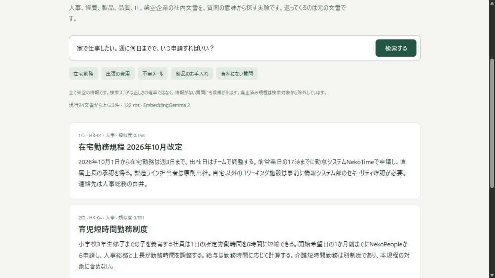
</p>

## 自分の資料で試す

PodmanかDocker（Composeつき）が動く環境があれば試せます。GPUもHugging Faceのログインも不要です。コンテナに8GBのメモリを割り当ててください。

```bash
git clone https://github.com/Sunwood-ai-labs/embeddinggemma2-nekoneko-search.git
cd embeddinggemma2-nekoneko-search/quickstart
podman compose build
podman compose run --rm bench python fetch_model.py      # 固定revisionの重みを取得（約3GB）

cp -r ../benchmark/inputs/* inputs/                      # 架空の資料で試す場合。自分の資料を置いてもよい
podman compose run --rm bench python build_index.py      # → out/index.jsonl, out/index-vectors.npy
podman compose run --rm bench python search.py "在宅勤務は週に何日まで？"

# 実験の生の検索結果を採点する（記事と同じ数字が出る）。コンテナ不要、Python標準ライブラリのみ
cd .. && python quickstart/score.py results/multimodal/raw/test-query-results.jsonl benchmark/gold.jsonl
```

対応する資料は docx、pdf、xlsx、pptx、txt、md、音声（wav、mp3、m4a、flac）、動画（mp4、mov、mkv、webm）です。動画は6秒につき約25秒かかります。

| ファイル | 内容 | 確認状況 |
| --- | --- | --- |
| [`quickstart/build_index.py`](quickstart/build_index.py) | 資料を区切ってベクトルにする | 実験のイメージ内で実行。文書7点・音声1本・動画1本の43単位が、実験のベクトルと一致（cosine 1.0） |
| [`quickstart/chunking.py`](quickstart/chunking.py) | 形式ごとの区切り方 | 同上。txt、md、mp3 などwav・mp4以外の形式は未実行 |
| [`quickstart/search.py`](quickstart/search.py) | 質問で検索する | 実験のイメージ内で、1問と60問まとめての両方を実行 |
| [`quickstart/score.py`](quickstart/score.py) | Hit@k と MRR@10 の採点 | `results/` の実出力で記事と同じ数字になることを確認 |
| [`quickstart/fetch_model.py`](quickstart/fetch_model.py) | モデルの取得 | 取得済みキャッシュでの実行のみ確認。新規ダウンロードは未実行 |
| [`quickstart/Containerfile`](quickstart/Containerfile) | 実験の2つのイメージを1つにまとめた定義 | Podmanでビルドし、できたイメージで `search.py` を実行 |
| [`quickstart/compose.yaml`](quickstart/compose.yaml) | CPU 4コア・メモリ8GBの設定 | `compose` 経由では未実行 |

## フォルダ構成

| フォルダ | 内容 |
| --- | --- |
| `quickstart/` | 自分の資料で試すための一式 |
| `experiment/text-search/` | 文章だけの予備実験。検索画面つきのサービスと評価スクリプト |
| `experiment/multimodal/` | 本測定。区切り、埋め込み、検索、集計、独立再集計のスクリプトと固定した条件 |
| `benchmark/` | 架空の社内資料（Word・PDF・Excel・PowerPoint）、質問75問、正解、動画ごとのQA |
| `results/` | 実測結果。生の検索結果、集計CSV、質問別の結果、実行環境の記録 |
| `docs/` | 実測レポート、独立再集計、事前調査メモ、予備実験のレポート |
| `assets/` | ヘッダー画像、グラフ、入力資料のタイル画像、生成スクリプト（`make_charts.py`、`make_header.py`、`make_input_tiles.py`） |

`experiment/` のスクリプトは、実験時のフォルダ構成と音声・動画の素材を前提にしています。音声2本と動画5本、モデルの重み、実行ログはこのリポジトリに含めていないため、そのままでは本測定を再現できません。処理内容の参照用です。動画と音声の内容は、上のタイル画像、[`benchmark/QA_LIST.md`](benchmark/QA_LIST.md) の質問と正解、[`results/multimodal/index.jsonl`](results/multimodal/index.jsonl) の区間一覧で確認できます。

グラフは実測値から作り直せます。入力資料のタイル画像（`make_input_tiles.py`）は、リポジトリに含めていないページ画像・動画のフレーム・音声ファイルから作っています。

```bash
python assets/make_charts.py && python assets/make_header.py
```

## 使用したモデルとランタイム

| 役割 | モデル・ランタイム |
| --- | --- |
| 埋め込み | [google/embeddinggemma-2](https://huggingface.co/google/embeddinggemma-2) revision `914f7f89`、float32、768次元。本測定は全744,371,488パラメータ、予備実験は文章用の271,002,624パラメータ |
| 呼び出し | [Sentence Transformers](https://sbert.net/) 6.1.0、Transformers 5.19.0、PyTorch 2.14.1（CPU） |
| 資料の読み取り | python-docx 1.2.0、PyMuPDF 1.26.7、openpyxl 3.1.5、python-pptx 1.0.2、FFmpeg 7.1 |
| 実行基盤 | Podman Compose（WSL2）、Python 3.12、Core i7-13620H、コンテナに4コア・8GB |

モデルの利用条件は、配布元の記載（Apache 2.0）に従ってください。このリポジトリ自体のライセンスは未設定です。
